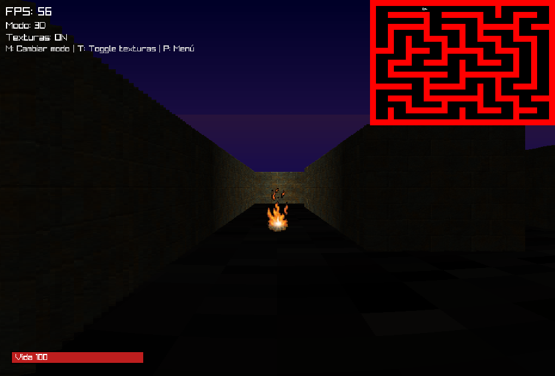

# Raycaster en Rust

> Juego de laberinto en primera persona con un raycaster propio en Rust y Raylib

[](https://github.com/DiegoOF07/rust-raycaster/actions/workflows/ci.yml)



[Video del juego en YouTube](https://www.youtube.com/watch?v=8QwW1_mKImg) (grabado antes de agregar la vida y las trampas).

Un raycaster al estilo de Wolfenstein 3D: por cada columna de la pantalla se lanza un rayo sobre un mapa 2D, y la distancia a la pared decide qué tan alta se dibuja. Paredes, piso, cielo y sprites se pintan píxel por píxel en un framebuffer propio; Raylib solo abre la ventana, muestra la imagen y reproduce el audio.

## Qué hace

- **3 niveles** con su propia textura de paredes y piso, y su propia música.
- **Un objetivo:** encontrar la llave en el laberinto sin morir en el camino.
- **Trampas y curaciones:** los pinchos y el fuego quitan vida; las curaciones la devuelven.
- **Sprites animados** (fuego y curaciones) que respetan la profundidad de las paredes.
- **Sonido:** música por nivel, pasos mientras caminas y un quejido al recibir daño.
- **Minimapa** en la esquina, vista 2D del mapa con los rayos y modo sin texturas.

| Regla | Valor |
|---|---|
| Vida inicial | 100 |
| Pinchos o fuego | −20, con 1 s de invulnerabilidad después del golpe |
| Curación | +25, sin pasar de 100; se queda en el piso si tienes la vida llena |
| Llave | ganas el nivel |

## Stack

Rust (edición 2024) · Raylib 5.5 (ventana y presentación) · rodio (audio) · image (texturas)

## Cómo funciona

```
cast.rs                 avance de un rayo sobre el mapa hasta la primera pared
renderer.rs             una columna por rayo: paredes, piso, cielo y profundidad
sprites.rs              sprites ordenados por distancia y recortados con la profundidad
gameplay.rs             vida, trampas, curaciones y llave, sin ventana ni audio
game.rs                 carga de niveles desde texto y minimapa
audio_manager.rs        música, pasos en bucle y efectos
texture.rs              texturas cargadas y texturas generadas por código
```

Los niveles son archivos de texto en `levels/`: `+`, `-` y `|` son paredes; `O` es la llave, `A` los pinchos, `F` el fuego y `H` las curaciones.

## Cómo correrlo

Requiere Rust estable y las dependencias de compilación de Raylib (CMake y un compilador de C); en Linux, además, ALSA para el audio. Se corre desde la raíz del repo, porque las texturas, los niveles y el audio se cargan de ahí.

```bash
cargo run --release
```

| Tecla | Acción |
|---|---|
| W / S o ↑ / ↓ | avanzar o retroceder |
| A / D o Q / E | moverse de lado |
| Mouse o ← / → | girar |
| M | vista 3D o mapa 2D |
| T | texturas sí o no |
| P | volver al menú |
| Enter | en el menú, jugar; al terminar un nivel, volver al menú |
| Esc | salir |

## Decisiones y aprendizajes

- **Las reglas, separadas de la ventana.** `gameplay.rs` no sabe nada de Raylib ni del audio: recibe la posición del jugador y los sprites, y devuelve eventos como "recibió daño" o "ganó". Así se prueba sin abrir el juego, y `main.rs` solo convierte esos eventos en sonidos y efectos.
- **Cada nivel se puede ganar.** Una prueba recorre el mapa desde la casilla inicial y verifica que la llave sea alcanzable en los 3 niveles.
- **Leer el teclado al final del cuadro.** Raylib actualiza el teclado al terminar de dibujar; si el juego cambia de pantalla a mitad de un cuadro, la siguiente pantalla ve la misma tecla recién presionada. Por eso volver al menú ocurre después de dibujar.

Proyecto 1 del curso Gráficas por Computadora, UVG, 2025.
